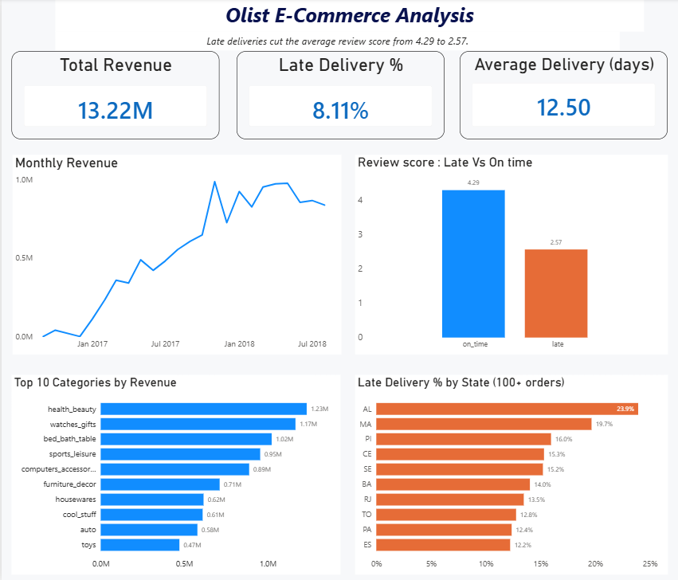
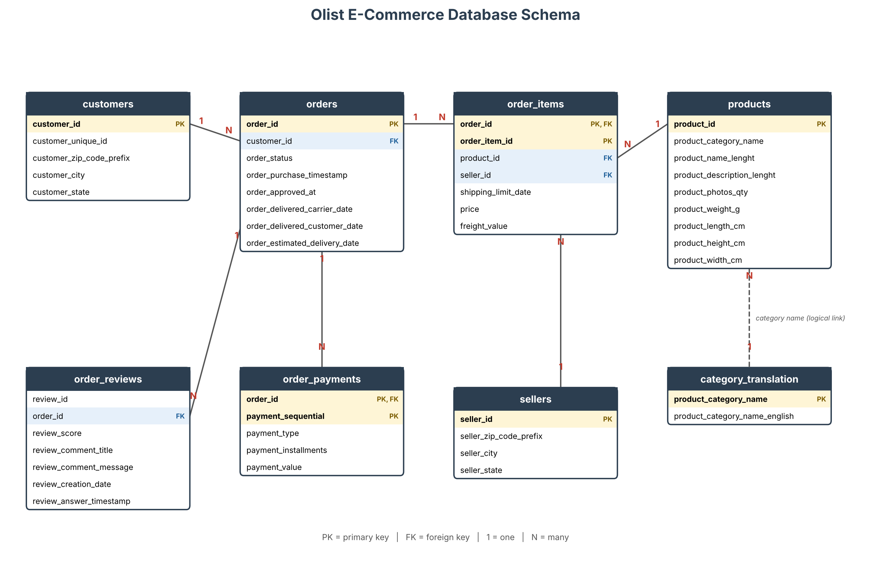

# Olist E-Commerce Analysis (PostgreSQL + Power BI)

I analysed the Olist Brazilian e-commerce dataset to understand how the business sells, how well it delivers, and whether late deliveries hurt customer reviews. I did the analysis in PostgreSQL and built a one-page dashboard in Power BI.

**Main finding:** orders that arrive late get an average review score of **2.57**, compared with **4.29** for orders that arrive on time.

## Dataset

[Brazilian E-Commerce Public Dataset by Olist](https://www.kaggle.com/datasets/olistbr/brazilian-ecommerce) from Kaggle. It has orders placed between Sep 2016 and Oct 2018. I used 8 of the 9 files (customers, sellers, products, category translation, orders, order items, order payments, order reviews). I skipped the geolocation file because I did not need it.

All money values are in BRL (Brazilian real).

## Tools

- PostgreSQL 17 and pgAdmin (SQL analysis)
- Power BI Desktop (dashboard)

## Database schema

## How I approached it

1. **Data checks.** Before any analysis I checked the date range, missing delivery dates, duplicate reviews, blank categories, missing translations and wrong prices.
2. **Staging views.** I made three views so I did not have to repeat the same filters in every query:
   - `stg_delivered_orders`: delivered orders that have a delivery date
   - `stg_sales`: one row per item sold, with the category name in English
   - `stg_delivery`: one row per delivered order with state, delivery days, late flag and review score (used for Power BI)
3. **Analysis.** 10 queries on revenue, payments, delivery time and reviews, using joins, CTEs, window functions (`lag`), `case when` and subqueries. Every query in the SQL file has a comment on why I wrote it and what I found.
4. **Dashboard.** A one-page Power BI report built on the views.

## Key findings

**Sales**
- Total revenue was **13.22M BRL** from **96,470** delivered orders (product price only, freight not included).
- Revenue grew through 2017 and peaked in **Nov 2017 (about 0.99M)**, then stayed between about 0.83M and 0.98M a month in 2018.
- Top categories: `health_beauty` (1.23M), `watches_gifts` (1.17M) and `bed_bath_table` (1.02M).
- The top 10 sellers together bring only about 13% of revenue (the best one about 227K), so sales are spread over many sellers.
- Customers mostly pay by credit card (**78.34%**), then boleto (**17.92%**).

**Delivery and reviews**
- **8.11%** of delivered orders arrived after the promised date. The average delivery took about **12.5 days**.
- Average review score: **4.29** for on-time orders and **2.57** for late orders.
- Late delivery is worst in the north and north-east. Among states with at least 100 orders: **AL 23.9%**, **MA 19.7%**, PI 16.0%, CE 15.3% and SE 15.2%. BA (14.0%) and RJ (13.5%) are also high, and both are among the biggest states by orders.

## Recommendations

1. **Look at the delivery promise in the worst states (AL, MA, PI, CE, SE).** If orders there are late so often, the estimated date is probably too optimistic. Giving a more realistic date, or improving delivery in those areas, could protect review scores.
2. **Focus on BA and RJ first.** Their late rates are high and they have many orders, so fixing them would reach more customers than fixing the small states.

The review gap shows a link between lateness and low scores. It does not prove that lateness is the only reason, because other problems (like damaged products) may also be involved.

## Data notes and limits

- 96,478 orders are marked delivered, but 8 of them have no delivery date. I left those 8 out, so the analysis uses 96,470 orders.
- 547 orders have more than one review. In the `stg_delivery` view I average the reviews per order. The SQL review query counts each review, so its numbers can differ slightly from the dashboard.
- 610 products have no category (shown as `unknown`), and 2 categories have no English translation (`pc_gamer` and `portateis_cozinha_e_preparadores_de_alimentos`), so I used their Portuguese names.
- Orders run from Sep 2016 to Oct 2018, but delivered revenue stops in Aug 2018. Late 2016 has very little data and Nov 2016 has none. Because of this, the month-over-month growth for Dec 2016 and Jan 2017 is not meaningful.
- The payment split uses all orders and includes freight, so its total (about 16.0M) is higher than the 13.22M product revenue.
- The state chart only shows states with at least 100 orders, because the percentage is not reliable for very small states.

## Files

| File | What it is |
|---|---|
| `create_tables.sql` | Creates the 8 tables |
| `olist_analysis.sql` | Data checks, views and all analysis queries, with comments |
| `olist_dashboard.pbix` | Power BI dashboard |
| `schema_diagram.png` | Database schema |
| `dashboard.png` | Dashboard screenshot |

## How to run it

1. Download the dataset from Kaggle.
2. Create an empty PostgreSQL database and run `create_tables.sql`.
3. Load the CSV files into the tables in this order: customers, sellers, category_translation, products, orders, order_items, order_payments, order_reviews (header on).
4. Run `olist_analysis.sql` from top to bottom. It drops and recreates the views, so it can be run again.
5. Open `olist_dashboard.pbix` and change the data source to your own PostgreSQL database.

## What I practised

- Writing joins, CTEs, window functions, subqueries and `case when` in PostgreSQL
- Checking data quality before analysing it
- Building clean views as a base for reporting
- Turning query results into a Power BI dashboard and a short list of recommendations

---
Made by Rhythem Dubey
